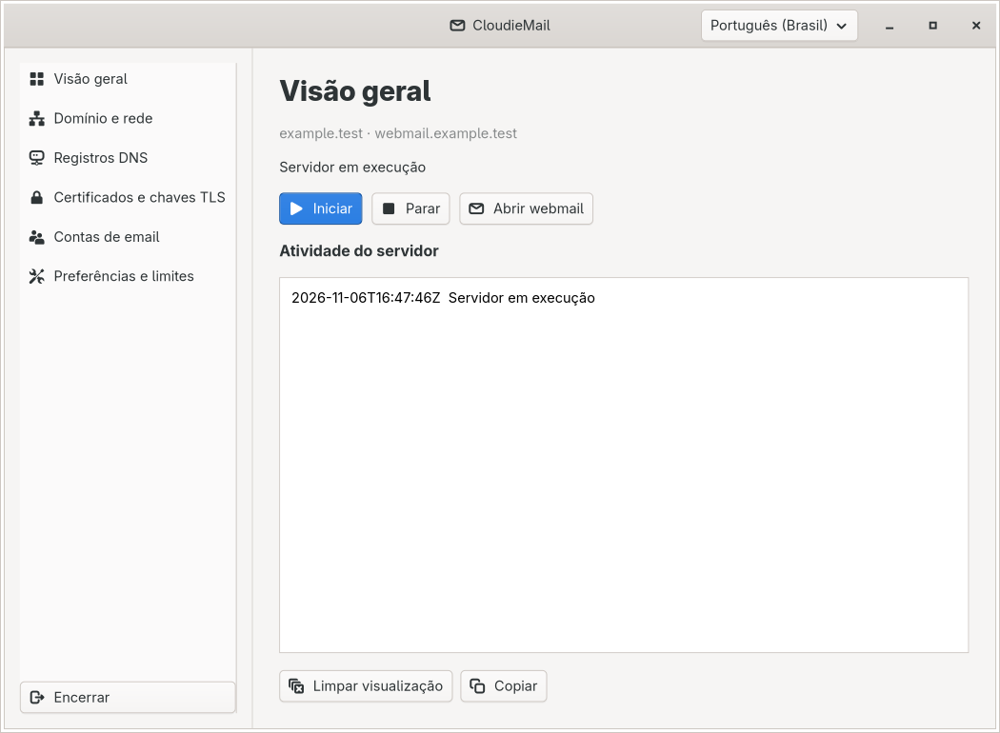
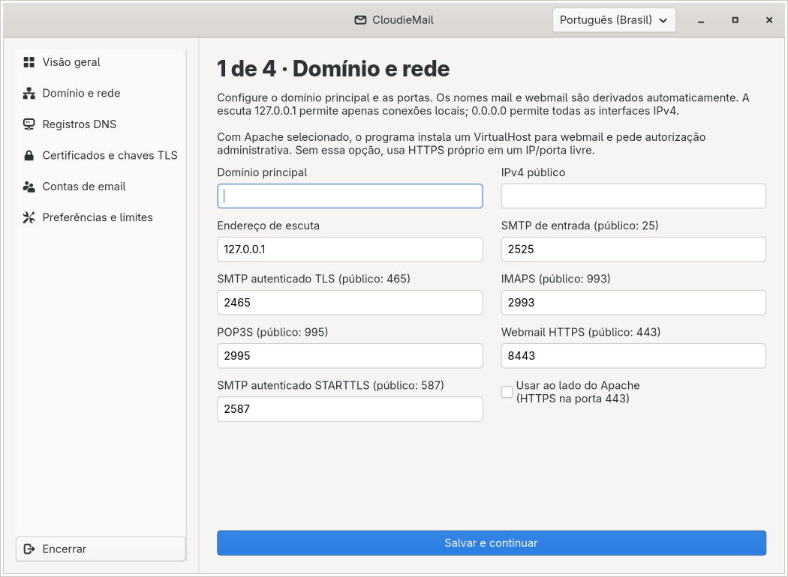
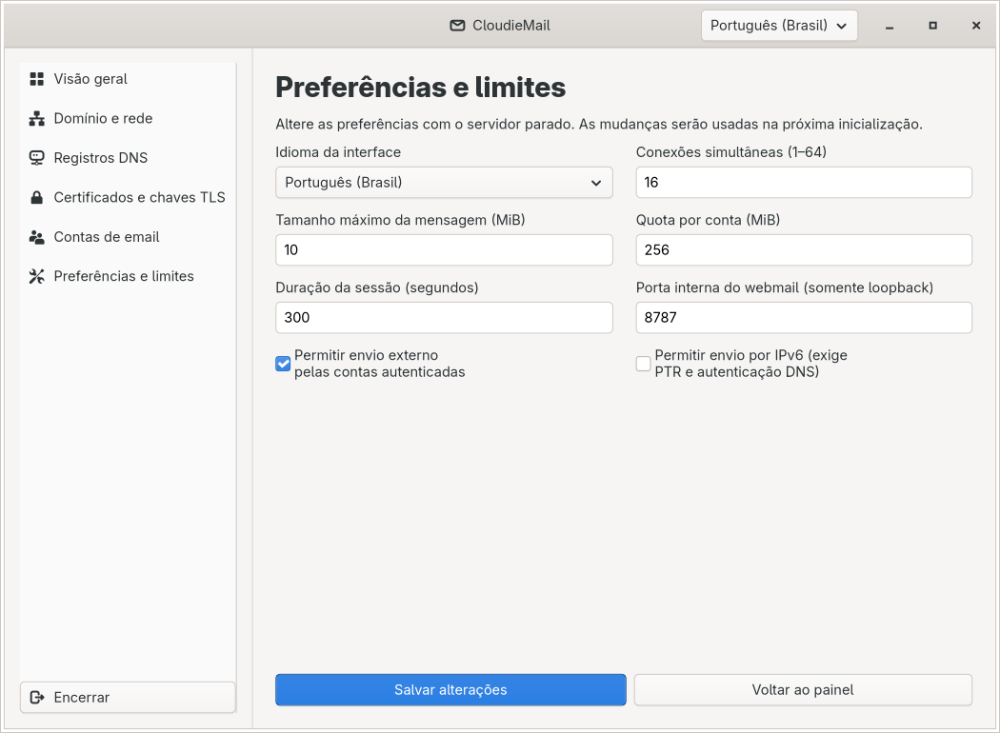
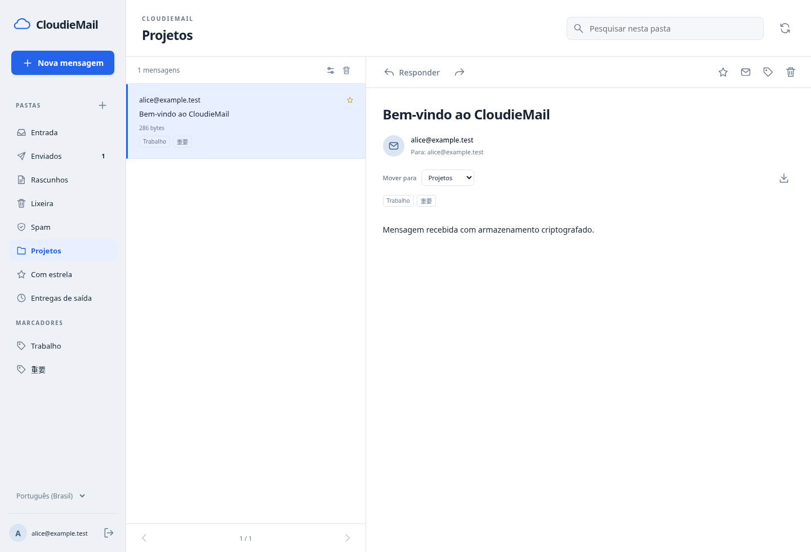

# CloudieMail

Servidor de email para Linux e Windows, com administração por interface gráfica ou terminal e webmail integrado. Escrito em C++20, usa Firebird 5 para armazenamento, GTK4 no Linux e controles nativos do Windows.

[Baixar a versão mais recente](https://github.com/Cloudie-Code/CloudieMail/releases) · [Configuração](docs/CONFIGURATION.md) · [Compilação](docs/BUILDING.md) · [Segurança](docs/SECURITY.md)

> **v0.2.0:** IMAP com pastas, anexos, busca, flags persistentes e sincronização IDLE, além de filtro antispam integrado. Testado em servidor no Windows com o Mail do iOS. Veja os [recursos de IMAP e antispam](docs/IMAP-ANTISPAM.md) e os [testes da versão](docs/STATUS.md).

## Interface Linux

A interface acompanha o tema GTK do sistema. As capturas abaixo usam um domínio e uma conta de demonstração.



<details>
<summary>Assistente e configurações</summary>





</details>

## Webmail

Pastas, marcadores, busca, anexos, rascunhos e acompanhamento das entregas em uma interface que também se adapta ao celular.



## Recursos

- SMTP com STARTTLS, SMTPS e submissão autenticada com o email e a senha da conta.
- Entrega direta aos MX de destino, assinatura DKIM, fila criptografada e novas tentativas em falhas temporárias.
- POP3S e IMAPS com pastas, APPEND/COPY/MOVE, busca, flags persistentes, ENVELOPE/BODYSTRUCTURE e IDLE.
- Antispam de entrada com pontuação, verificação do remetente e encaminhamento de mensagens suspeitas para Lixo eletrônico.
- Assistente de domínio, DNS manual ou Cloudflare, certificados Let's Encrypt e primeira conta.
- Webmail HTTPS em `webmail.seudominio.com`.
- HTTP.sys no Windows para compartilhar a porta 443 com outros sites; integração opcional com Apache no Linux.
- Contas e mensagens armazenadas com criptografia, troca de senha e limites de sessão, conexões e tamanho de mensagem.
- Bandeja do sistema, logs e administração pelo terminal.
- Português brasileiro, inglês, japonês, coreano e chinês tradicional.

## Instalação

Baixe o pacote do seu sistema na página de [releases](https://github.com/Cloudie-Code/CloudieMail/releases). Os pacotes incluem os executáveis, Firebird, webmail e dependências de execução.

| Pacote | Requisitos | Abrir |
| --- | --- | --- |
| Windows x64 | Windows 10 ou posterior; permissões administrativas para preparar HTTP.sys | `CloudieMail.cmd` |
| Linux x86-64-v3 | CPU com x86-64-v3, kernel 6.1 ou posterior e sessão gráfica para a GUI | `CloudieMail.sh` |

O pacote Linux é construído em CachyOS e inclui bibliotecas desse ambiente. Para outras arquiteturas ou distribuições incompatíveis, [compile a partir do código](docs/BUILDING.md). O código Windows usa MSVC `/MT`; no Linux, o runtime GCC/C++ é estático e as demais bibliotecas são distribuídas junto ao programa.

1. Extraia o pacote em uma pasta gravável pelo usuário que vai executar o servidor.
2. Abra o programa e siga o assistente: domínio e rede → DNS → certificado → primeira conta.
3. Confira as portas no firewall e clique em **Iniciar**.

Para usar o terminal, execute `Console.sh` ou `Console.cmd`. Sem argumentos, o lançador abre o assistente. Não é necessário editar o banco ou criar arquivos JSON manualmente.

## Domínio e entrega de email

O domínio principal define os endereços das contas. `mail.seudominio.com` atende SMTP, IMAP e POP3; `webmail.seudominio.com` atende o navegador.

- Mantenha `mail` como **DNS-only**, sem proxy HTTP do Cloudflare.
- A entrega direta precisa de saída TCP 25, PTR válido e autenticação SPF/DKIM. O provedor do IP configura o PTR.
- O SMTP de saída usa IPv4 por padrão. Habilite IPv6 nas preferências somente depois de configurar seu DNS reverso e autenticação.
- O token Cloudflare configura DNS e desafios de certificado. Não é uma credencial de relay SMTP.
- O CloudieMail autentica seus clientes e entrega ao destino; não há relay externo configurável nesta versão.

Veja [portas, certificados, clientes de email e atualizações](docs/CONFIGURATION.md).

## Segurança e backups

Cada conta recebe chaves aleatórias. A senha protege a chave privada com Argon2id e XChaCha20-Poly1305; as mensagens são criptografadas antes de serem gravadas no banco. Isso protege o armazenamento, mas não é criptografia ponta a ponta: o servidor processa mensagens em texto durante o recebimento e sessões autenticadas.

Pare o servidor antes de copiar `config/` e `data/`. Preserve também certificados ou chaves armazenados fora dessas pastas. A perda da senha pode impedir o acesso ao histórico; não há recuperação administrativa nesta versão.

Leia o [modelo de segurança](docs/SECURITY.md) e as [limitações](docs/ROADMAP.md).

## Desenvolvimento

```bash
git clone https://github.com/Cloudie-Code/CloudieMail.git
cd CloudieMail
bash scripts/bootstrap-linux.sh
bash scripts/build-linux.sh --static-runtime
```

As dependências de desenvolvimento e as instruções para MSVC estão em [BUILDING.md](docs/BUILDING.md). A organização do código está em [ARCHITECTURE.md](docs/ARCHITECTURE.md).

## Licença

O código do CloudieMail usa a [licença MIT](LICENSE). As bibliotecas e ferramentas incluídas nos pacotes mantêm suas próprias licenças; consulte [THIRD-PARTY.md](docs/THIRD-PARTY.md), `THIRD-PARTY.json` e a pasta `licenses/` do pacote.
